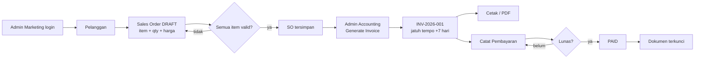

# PRD — SpillBill (Order-to-Invoice System untuk UMKM)

| Field | Value |
|---|---|
| Produk | SpillBill |
| Versi dokumen | 1.0 |
| Tanggal | 27 Oktober 2026 |
| Status | Baseline untuk desain prototype (Stitch) |
| Sumber | `README.md`, `srs-spillbill.docx`, `use-case-description-spillbill.docx`, `class-diagram`, `state-machine-diagram`, `activity-diagram`, `sequence-diagram`, `object-diagram`, `deployment-diagram` |
| Dokumen turunan | `prototype.md` (prompt & spesifikasi layar untuk Google Stitch) |

---

## 1. Ringkasan Produk

SpillBill adalah aplikasi web **Order-to-Invoice** untuk UMKM: mencatat pelanggan, membuat Sales Order (SO), mengubah SO menjadi Invoice dalam satu klik, mencetak/mengunduh invoice, lalu mencatat pembayaran (parsial maupun lunas) hingga status tagihan berubah otomatis.

**Nilai inti:** satu alur tanpa rekap manual — `Pelanggan → Sales Order → Invoice → Pembayaran → Lunas`.

**Positioning UI:** SaaS modern 2026 — bersih, padat informasi, tegas secara tipografi, dengan dashboard yang "hidup" (chart + ilustrasi), bukan tabel kosong.

---

## 2. Masalah & Tujuan

### 2.1 Masalah
- UMKM mencatat pesanan dan tagihan di spreadsheet/WhatsApp → nomor invoice tidak konsisten, piutang tidak terpantau, dokumen tidak siap cetak.
- Tidak ada pemisahan tugas antara yang menjual dan yang menagih.

### 2.2 Tujuan produk
| ID | Tujuan | Metrik |
|---|---|---|
| G-01 | Menerbitkan invoice dari SO tanpa input ulang | invoice terbit < 3 navigasi, 1 klik dari detail SO |
| G-02 | Mengetahui posisi piutang kapan saja | dashboard memuat total piutang & jumlah overdue |
| G-03 | Mencegah data transaksi berubah setelah mengikat | 0 edit/hapus pada SO `INVOICED` & invoice `PAID` |
| G-04 | Jejak audit tersedia | 100% create/update/delete tercatat di `History` |

---

## 3. Persona & Hak Akses

| Persona | Alias di dokumen | Tanggung jawab |
|---|---|---|
| **Admin Marketing** | "Admin Sales" (state machine) | Kelola pelanggan, produk, dan Sales Order |
| **Admin Accounting** | "Admin Invoice" (state machine) | Terbitkan invoice, cetak, catat & koreksi pembayaran |

> Catatan: dokumen sumber memakai dua penamaan untuk peran yang sama. PRD memakai **Admin Marketing** dan **Admin Accounting**; label UI memakai `Marketing` dan `Accounting`.

### 3.1 Matriks RBAC

| Modul | Marketing | Accounting |
|---|---|---|
| Dashboard | ✅ (versi sales) | ✅ (versi finance) |
| Pelanggan | ✅ CRUD | 👁 lihat (read-only) |
| Produk | ✅ CRUD | 👁 lihat |
| Sales Order | ✅ CRUD (selama `DRAFT`) | 👁 lihat |
| Invoice | 👁 lihat | ✅ buat/ubah/hapus (selama belum `PAID`) + cetak |
| Pembayaran | 👁 lihat | ✅ CRUD |
| Riwayat Aktivitas | 👁 | 👁 |

Akses di luar matriks → menu tidak dirender (bukan sekadar disabled) + route guard.

---

## 4. Lingkup

### 4.1 In scope
1. Login & session berbasis role.
2. CRUD pelanggan (soft delete).
3. CRUD produk (master data; dipakai sebagai item pesanan).
4. CRUD Sales Order dengan baris item dinamis + kalkulasi instan.
5. Konversi SO → Invoice (1 klik), nomor invoice unik, tanggal jatuh tempo.
6. Cetak / unduh PDF invoice (print-friendly).
7. Pencatatan pembayaran parsial/lunas + bukti bayar.
8. Dashboard statistik (omzet, piutang, overdue) + chart.
9. Riwayat aktivitas (audit log read-only).

### 4.2 Out of scope (fase ini)
- Payment gateway / rekonsiliasi bank otomatis; pembayaran diverifikasi manual.
- Pengiriman invoice via email (TBD-01).
- Multi-tenant / multi-cabang, pajak (PPN), diskon, mata uang selain IDR.
- Manajemen stok kuantitatif (lihat §12.2).

---

## 5. Alur Bisnis End-to-End



Status SO `INVOICED` setelah minimal satu invoice terbit. Setelah itu SO terkunci (BR-04).

---

## 6. Functional Requirements

### 6.1 Autentikasi (`FR-AUTH`)
| ID | Requirement |
|---|---|
| FR-AUTH-01 | Login dengan username/email + password; verifikasi ke database. |
| FR-AUTH-02 | Kredensial valid → session dimuat, redirect ke dashboard sesuai role. |
| FR-AUTH-03 | Kredensial salah → pesan error generik ("Username atau password salah"), form tetap. |
| FR-AUTH-04 | Field kosong → validasi inline sebelum submit. |
| FR-AUTH-05 | Logout mengakhiri session; akses route terproteksi tanpa session → login. |
| FR-AUTH-06 | User non-aktif (`active=false`) tidak dapat login. |

### 6.2 Pelanggan (`FR-CUST`)
| ID | Requirement |
|---|---|
| FR-CUST-01 | Daftar pelanggan dengan pencarian (nama/email/telepon) dan pagination. |
| FR-CUST-02 | Tambah & ubah pelanggan: nama (wajib), email, telepon, alamat, catatan. |
| FR-CUST-03 | Detail pelanggan menampilkan ringkasan transaksi: jumlah SO, total tagihan, sisa piutang. |
| FR-CUST-04 | Hapus hanya jika belum punya riwayat transaksi (BR-01); jika tidak, aksi disabled dengan alasan. |
| FR-CUST-05 | Email unik per pelanggan bila diisi. |

### 6.3 Produk (`FR-PROD`, diturunkan dari class diagram)
| ID | Requirement |
|---|---|
| FR-PROD-01 | CRUD produk: nama, harga satuan, status aktif. |
| FR-PROD-02 | Produk non-aktif tidak muncul di pemilih item SO; tetap tampil di dokumen lama. |

### 6.4 Sales Order (`FR-ORD`)
| ID | Requirement |
|---|---|
| FR-ORD-01 | Buat SO dengan memilih pelanggan terdaftar (searchable select). |
| FR-ORD-02 | Baris item dinamis: tambah/hapus baris, pilih produk, qty, harga satuan (default dari produk, dapat diubah). |
| FR-ORD-03 | Subtotal per baris & grand total dihitung instan di client (< 100 ms). |
| FR-ORD-04 | Nomor SO unik `SO-YYYY-NNN`. |
| FR-ORD-05 | Edit/hapus hanya saat `DRAFT` (BR-04). |
| FR-ORD-06 | Daftar SO: filter status, pencarian nomor/pelanggan, indikator sisa qty yang belum ditagih. |

### 6.5 Invoice (`FR-INV`)
| ID | Requirement |
|---|---|
| FR-INV-01 | Generate invoice dari SO dengan satu klik; item & harga terisi otomatis dari SO. |
| FR-INV-02 | Nomor unik `INV-YYYY-NNN` + `invoiceDate` + `dueDate` (default +7 hari). |
| FR-INV-03 | Invoice parsial diperbolehkan: qty yang ditagih per item ≤ sisa qty SO (BR-06). |
| FR-INV-04 | Cetak / unduh PDF dengan layout faktur resmi (header penjual, data pelanggan, tabel item, total, status, rekening, catatan). |
| FR-INV-05 | Edit/hapus hanya bila belum `PAID` (BR-08). |
| FR-INV-06 | Daftar invoice: filter status (`UNPAID`/`PARTIALLY_PAID`/`PAID`/`OVERDUE`), rentang tanggal, pencarian. |

### 6.6 Pembayaran (`FR-PAY`)
| ID | Requirement |
|---|---|
| FR-PAY-01 | Catat pembayaran: invoice, jumlah, tanggal, metode, referensi, bukti bayar (opsional). |
| FR-PAY-02 | Jumlah tidak boleh melebihi sisa tagihan (BR-09) → tampilkan peringatan + sisa tagihan. |
| FR-PAY-03 | Status invoice diperbarui otomatis setelah simpan/void (BR-10). |
| FR-PAY-04 | Riwayat pembayaran: filter invoice/metode/tanggal, kolom jumlah & status. |
| FR-PAY-05 | Edit/void pembayaran hanya oleh Accounting; void memicu rekalkulasi status invoice. |

### 6.7 Dashboard & Riwayat (`FR-DASH`, `FR-HIST`)
| ID | Requirement |
|---|---|
| FR-DASH-01 | Kartu KPI: total omzet (pembayaran sukses), total piutang, jumlah invoice overdue; dilengkapi tren 6 bulan, komposisi status invoice, dan 5 aktivitas terbaru. |
| FR-DASH-02 | Dashboard Marketing menonjolkan SO baru, pelanggan baru, SO belum ditagih. |
| FR-DASH-03 | Dashboard Accounting menonjolkan piutang jatuh tempo, pembayaran terbaru, invoice belum lunas. |
| FR-HIST-01 | Riwayat aktivitas: waktu, aktor, aksi, tipe entitas, ID entitas, deskripsi; filter & pencarian; read-only. |

---

## 7. Aturan Bisnis (otoritatif — wajib tercermin di prototype)

| ID | Aturan | Perilaku UI |
|---|---|---|
| BR-01 | Pelanggan hanya dihapus jika belum memiliki riwayat transaksi | Tombol Hapus disabled + tooltip "Pelanggan sudah memiliki transaksi" |
| BR-02 | SO wajib punya pelanggan terdaftar dan ≥1 item valid (qty > 0, harga ≥ 0) | Tombol Simpan disabled sampai valid |
| BR-03 | Simpan SO gagal jika pelanggan/produk tidak ditemukan atau non-aktif | Inline alert di form, form tetap terbuka |
| BR-04 | SO tidak dapat diedit/dihapus saat `INVOICED` | Badge "Locked" + tombol Edit/Hapus disabled |
| BR-05 | Invoice hanya dibuat dari SO `DRAFT` yang valid | SO `INVOICED` tidak muncul di pemilih |
| BR-06 | Total qty ditagih per item SO (akumulasi semua invoice) ≤ qty item SO | Qty input dibatasi `max`; sisa qty ditampilkan |
| BR-07 | Nomor dokumen unik & final: `SO-YYYY-NNN`, `INV-YYYY-NNN` | Nomor read-only, auto-generate |
| BR-08 | Invoice tidak dapat diedit/dihapus saat `PAID` | Badge "Paid – locked" + tombol disabled |
| BR-09 | Nominal pembayaran > 0 dan ≤ sisa tagihan | Validasi + tampilkan sisa tagihan |
| BR-10 | Status invoice otomatis: `UNPAID` (0) → `PARTIALLY_PAID` (parsial) → `PAID` (penuh); `OVERDUE` dihitung saat hari ini > `dueDate` dan belum `PAID` | Chip status konsisten di semua layar |
| BR-11 | Tidak ada hard delete: semua hapus = soft delete + entri `History` | Toast "Data dipindahkan ke arsip" + entri riwayat |
| BR-12 | RBAC sesuai §3.1 | Menu/aksi disembunyikan atau disabled dengan alasan |
| BR-13 | Tanggal jatuh tempo default +7 hari, dapat diubah saat membuat invoice | Date picker + preview status |
| BR-14 | Semua nilai uang dalam IDR, tanpa desimal, format `Rp1.500.000` | Right-aligned, tabular numbers |

---

## 8. Model Data (dari class diagram)

| Entitas | Atribut inti |
|---|---|
| `User` | id, username, passwordHash, role, active |
| `Customer` | id, name, contactInfo (email/telepon/alamat) |
| `Product` | id, name, unitPrice, active |
| `SalesOrder` | id, orderNumber, orderDate, status, customer, items[] |
| `SalesOrderItem` | id, product, quantity, unitPrice, billedQty (turunan) |
| `InvoiceHeader` | id, invoiceNumber, salesOrder, invoiceDate, dueDate, status, details[], payments[] |
| `InvoiceDetail` | id, salesOrderItem, product, quantity, unitPrice |
| `Payment` | id, paymentDate, amount, method, status, reference, proofUrl |
| `History` | id, actor, action, entityType, entityId, occurredAt, description |

**Relasi kunci:** Customer `1—0..*` SalesOrder; SalesOrder `1—1..*` SalesOrderItem; SalesOrder `1—0..*` InvoiceHeader (parsial); InvoiceHeader `1—1..*` InvoiceDetail; InvoiceHeader `1—0..*` Payment; User `1—0..*` History.

### 8.1 Enum
```
UserRole        : ADMIN_MARKETING | ADMIN_ACCOUNTING
SalesOrderStatus: DRAFT | INVOICED | CANCELLED
InvoiceStatus   : UNPAID | PARTIALLY_PAID | PAID | OVERDUE (turunan)
PaymentMethod   : BANK_TRANSFER | EWALLET | CASH | OTHER
PaymentStatus   : SUCCESS | VOID
HistoryAction   : CREATE | UPDATE | DELETE | RECORD_PAYMENT | VOID_PAYMENT
```

---

## 9. State Machine Ringkas

**Sales Order:** `DRAFT → INVOICED` (auto saat invoice pertama terbit) · `DRAFT → CANCELLED` (soft delete). Dari `INVOICED` tidak ada transisi balik.

**Invoice:** `UNPAID → PARTIALLY_PAID → PAID`; `OVERDUE` = tampilan turunan dari `dueDate`; `* → CANCELLED` hanya bila belum ada pembayaran sukses.

**Payment:** `SUCCESS → VOID` (rekalkulasi status invoice), tidak ada hapus fisik.

**Login (alur UI):** Form Login → Memvalidasi Kredensial → Dashboard (valid) | Login Gagal → Form Login (invalid).

---

## 10. Format & Konvensi

| Item | Format | Contoh |
|---|---|---|
| Nomor SO | `SO-YYYY-NNN` | `SO-2026-001` |
| Nomor Invoice | `INV-YYYY-NNN` | `INV-2026-001` |
| ID entitas | `CUS-001`, `PRD-001`, `PAY-001` | — |
| Uang | IDR, tanpa desimal | `Rp2.000.000` |
| Tanggal | `dd MMM yyyy` (id-ID) | `26 Okt 2026` |
| Tanggal+jam (riwayat) | `dd MMM yyyy · HH:mm` | `26 Okt 2026 · 11:00` |

---

## 11. Non-Functional Requirements

| ID | Requirement |
|---|---|
| NFR-PERF-01 | First load < 2 s pada koneksi 4G; LCP < 2,5 s. |
| NFR-PERF-02 | Kalkulasi subtotal/total form SO < 100 ms (client-side). |
| NFR-SEC-01 | Kredensial DB/API hanya via environment variables; tidak ada secret di repo. |
| NFR-SEC-02 | Query parameterized; validasi input di server (trust boundary) untuk semua endpoint. |
| NFR-SEC-03 | RBAC ditegakkan di server, bukan hanya UI. |
| NFR-SAFE-01 | Soft delete + `History`; tidak ada kehilangan data saat error (transaksi atomik per aksi). |
| NFR-UX-01 | Invoice terbit maksimal 3 navigasi dari dashboard. |
| NFR-UX-02 | Responsif 1024×768 s.d. 1920×1080; tabel dapat di-scroll horizontal di layar kecil. |
| NFR-UX-03 | Status tidak pernah dikomunikasikan lewat warna saja (selalu ada label teks). |
| NFR-COMPAT-01 | Chrome, Edge, Firefox versi terkini. |

---

## 12. Design Brief (mengikat untuk prototype)

### 12.1 Arah visual
Modern SaaS 2026: grid lapang, tipografi tegas, sudut membulat sedang, garis tipis, bayangan halus, data-dense tetapi tenang. Kesan: alat kerja finance yang rapi, bukan aplikasi kasir.

### 12.2 Palet — maksimum 3 warna
| Peran | Token | Hex | Pemakaian |
|---|---|---|---|
| Primary | `--surface` | `#FFFFFF` | Latar utama, kartu, tabel |
| Secondary | `--navy-900` | `#0B1F3A` | Sidebar, teks utama, header tabel, chart utama |
| Accent | `--lime-500` | `#C6F24D` | CTA utama, highlight KPI, chart sekunder, badge sukses |
| Turunan (satu hue navy) | `--navy-50/100/300/600` | `#F4F7FB` `#E3EAF3` `#9AAABF` `#3B5273` | Border, hover, teks sekunder |

Aturan: lime **hanya sebagai latar/aksen dengan teks navy** (kontras ≥ 4,5:1); tidak ada hue keempat — status merah/kuning tidak dipakai, gunakan navy/lime + label teks + ikon.

### 12.3 Tipografi
- UI: Inter/Geist — 14/16 px, heading 20–32 px, `font-variant-numeric: tabular-nums` untuk angka.
- Hierarki: angka KPI besar (32–40 px, weight 600), label kecil uppercase tracking lebar.

### 12.4 Komponen & ilustrasi
- Chart: area/line tren omzet, bar stacked aging piutang (0–7, 8–30, >30 hari), donut komposisi status invoice.
- Ilustrasi: line-art dua warna (navy 20% + lime 60%) untuk empty state, login panel, dan header dashboard.
- Kartu KPI: angka + delta + sparkline mini; chip status; tabel dengan sticky header.

---

## 13. Risiko & Inkonsistensi Dokumen (perlu keputusan)

| # | Temuan | Dampak | Rekomendasi |
|---|---|---|---|
| R-01 | README/SRS menyebut **Supabase (PostgreSQL)**; deployment diagram menyebut **MySQL di Docker/VPS** | Arsitektur belum tunggal | Putuskan sebelum implementasi; prototype tidak terpengaruh |
| R-02 | Role dinamai "Admin Marketing/Accounting" dan "Admin Sales/Invoice" | Label menu bisa tidak konsisten | Pakai `Marketing`/`Accounting` (§3) |
| R-03 | `Product` ada di class diagram, tetapi tidak ada FR produk; state machine menyebut validasi "stok" | Pemilih item tanpa master data | Tambah `FR-PROD` (sudah di §6.3); stok kuantitatif = out of scope |
| R-04 | Use case mengizinkan hapus pembayaran, sedangkan BR-08 mengunci invoice `PAID` | Konflik aturan | Hapus = `VOID` + rekalkulasi; invoice `PAID` tetap terkunci untuk edit/hapus |
| R-05 | Tidak ada aturan pajak/diskon | Total bisa dipertanyakan | Tegaskan out of scope fase ini |
| R-06 | `History` tidak punya layar | Audit tidak terlihat | Tambah menu Riwayat (§6.7) |

---

## 14. Traceability (FR → layar prototype)

| Layar | FR | BR |
|---|---|---|
| Login | FR-AUTH-01..06 | BR-12 |
| Dashboard Marketing | FR-DASH-01/02 | BR-10, BR-12 |
| Dashboard Accounting | FR-DASH-01/03 | BR-10, BR-12 |
| Pelanggan (list/detail/form) | FR-CUST-01..05 | BR-01, BR-11 |
| Produk | FR-PROD-01/02 | BR-03, BR-12 |
| Sales Order (list/form/detail) | FR-ORD-01..06 | BR-02..04, BR-06, BR-13 |
| Invoice (list/builder/detail/print) | FR-INV-01..06 | BR-05..08, BR-10 |
| Pembayaran (list/form/detail) | FR-PAY-01..05 | BR-09, BR-10, BR-11 |
| Riwayat Aktivitas | FR-HIST-01 | BR-11, BR-12 |

---

## 15. Milestone

| Fase | Isi | Keluaran |
|---|---|---|
| M0 | Dokumentasi & PRD (dokumen ini) | Baseline requirement |
| M1 | Prototype UI (Stitch) seluruh layar §14 | Prototype high-fidelity + alur terhubung |
| M2 | Implementasi auth + pelanggan + produk | Modul master data |
| M3 | Sales Order + kalkulasi + generate invoice | Alur inti |
| M4 | Pembayaran, dashboard, riwayat, cetak PDF | Rilis kandidat |
