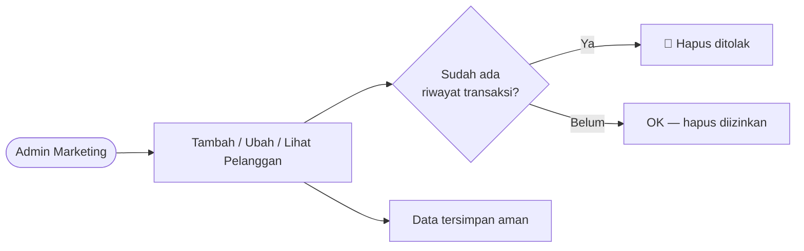
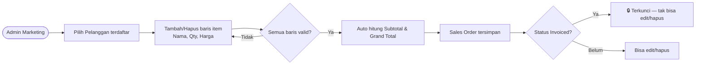
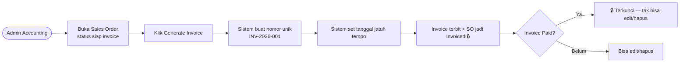
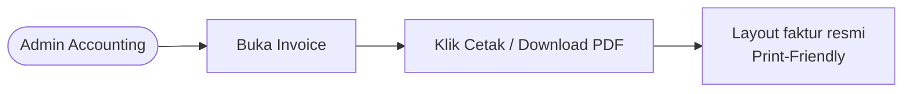
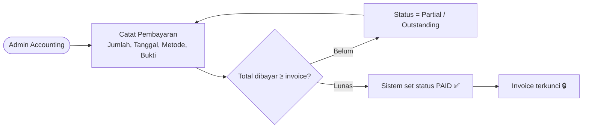
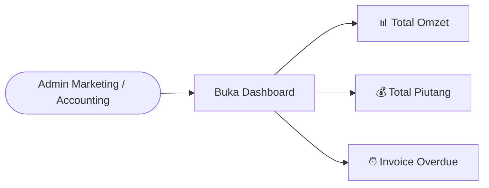

# Use Case Flow — SpillBill

Alur use case berdasarkan README & SRS. Diagram dalam Mermaid — bisa dirender di GitHub.

## Aktor

| Aktor | Tanggung Jawab | Modul |
|---|---|---|
| **Admin Marketing** | Kelola pelanggan & Sales Order | Sales Order (Izra) |
| **Admin Accounting** | Terbitkan invoice & catat pembayaran | Invoicing (Lazzian) + Payment (Syanaia) |
| **Sistem** | Kalkulasi, validasi status, statistik | — |

---

## UC-01 — Kelola Data Pelanggan

**Aktor:** Admin Marketing
**Dasar:** FR-CUST-01, FR-CUST-02

---

## UC-02 — Buat Sales Order

**Aktor:** Admin Marketing
**Dasar:** FR-ORD-01, FR-ORD-02, FR-ORD-03

---

## UC-03 — Generate Invoice (One-Click)

**Aktor:** Admin Accounting
**Dasar:** FR-INV-01, FR-INV-02

---

## UC-04 — Cetak / Download Invoice

**Aktor:** Admin Accounting
**Dasar:** FR-INV-03

---

## UC-05 — Catat Pembayaran

**Aktor:** Admin Accounting
**Dasar:** FR-PAY-01, FR-PAY-02

---

## UC-06 — Lihat Dashboard Statistik

**Aktor:** Admin Marketing & Admin Accounting
**Dasar:** FR-DASH-01

---

## Ringkasan Bisnis Rules

1. **Sales Order** tak dapat diedit/dihapus setelah status **Invoiced**.
2. **Invoice** tak dapat diedit/dihapus setelah status **Paid**.
3. Pelanggan hanya bisa dihapus jika **belum punya riwayat transaksi**.
4. Data yang dihapus → masuk tabel *history* (bukan hard-delete permanent).

---

## Relasi Modul ↔ Developer

| Use Case | Modul | Developer |
|---|---|---|
| UC-01, UC-02 | Sales Order | Izra |
| UC-03, UC-04 | Invoicing | Lazzian |
| UC-05, UC-06 | Payment | Syanaia |